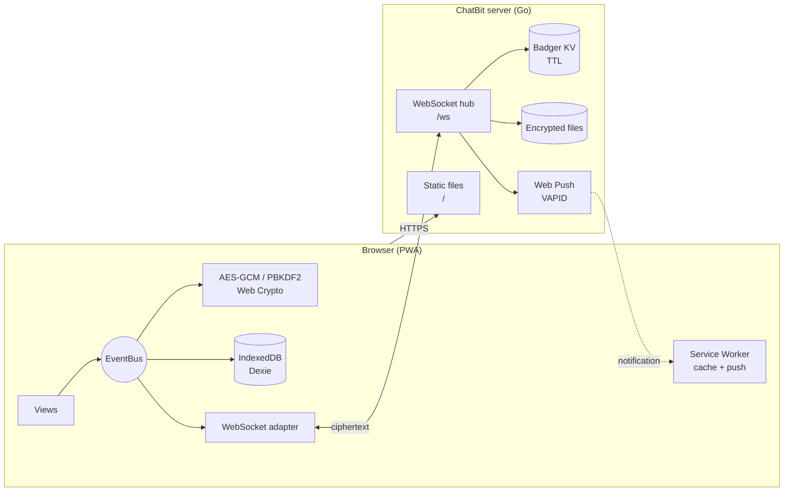
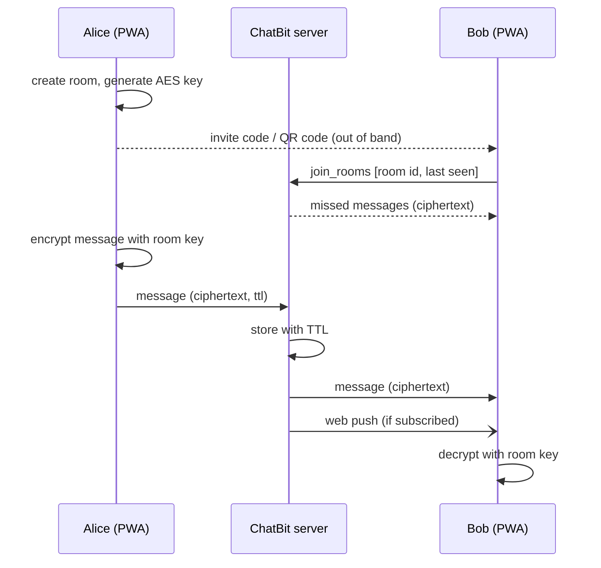

# ChatBit

End-to-end encrypted group chat as a Progressive Web App.

[](https://github.com/benonich/chatbit/actions/workflows/ci.yml)
[](go.mod)
[](dist/manifest.json)
[](LICENSE)

ChatBit encrypts every message and image in the browser with AES-256-GCM before it leaves the
device. The Go server only relays and temporarily stores ciphertext — it never sees room keys,
message content, names or images. There are no accounts: a room is joined with an invite code
or QR code that carries the room key.

## Table of Contents

- [Features](#features)
- [How It Works](#how-it-works)
- [Getting Started](#getting-started)
- [Configuration](#configuration)
- [Deployment](#deployment)
- [Project Structure](#project-structure)
- [WebSocket Protocol](#websocket-protocol)
- [Security Notes](#security-notes)
- [Roadmap](#roadmap)
- [License](#license)

## Features

- **End-to-end encryption** — AES-256-GCM per room, keys never leave the client unencrypted
- **No accounts** — local profile protected by a password (PBKDF2, 600 000 iterations)
- **Invite by QR code or code** — compact invite codes (`CB1-…`), optionally protected with a PIN;
  the QR code can also be scanned with the native camera app and pasted
- **Fast QR scanner** — native `BarcodeDetector` where available, zxing-cpp (WebAssembly) on iOS and Firefox
- **Images** — encrypted, chunked upload over the WebSocket with retry
- **Self-deleting messages** — every room has a maximum TTL that is set once when it is created and
  enforced by the server; single messages can be sent with a shorter TTL. Expired messages are
  deleted on the server and on every device (checked every minute), the remaining time is shown
  on each message. Images and other files live exactly as long as their message (at most 30 days).
- **Offline-capable PWA** — installable, cached app shell, automatic update notice
- **Web Push** — notifications for new messages (VAPID)
- **Reliable connection** — automatic reconnect with exponential backoff, outbox for messages sent while offline

## How It Works



1. **Profile** — on first start the user picks an alias and a password. A master key is derived
   with PBKDF2 and only kept in memory; room keys are stored in IndexedDB encrypted with it.
2. **Room** — creating a room generates a random AES-256 key in the browser.
3. **Invite** — the room id, key and name are packed into an invite code / QR code
   (optionally encrypted with a PIN) and shared out of band.
4. **Messages** — text and images are encrypted with the room key and sent over the WebSocket.
   The server forwards them to everyone in the room, stores them with a TTL and sends a push
   notification to subscribed members.
5. **Reconnect** — after a reconnect the client rejoins its rooms and receives the messages it missed.



## Getting Started

### Requirements

- [Go](https://go.dev/dl/) 1.27+
- [Task](https://taskfile.dev/) (optional, for builds with version info)
- Docker (optional)

### Run locally

```bash
git clone https://github.com/benonich/chatbit.git
cd chatbit
go run .
```

Open <http://localhost:8081>. On `localhost` the service worker does not cache anything, so
changes in `dist/` are visible after a reload.

> Camera access (QR scanner), service workers and push notifications require a secure context.
> They work on `localhost`; on any other host ChatBit has to be served over **HTTPS**.

### Build

```bash
task build:app        # binary in artifacts/chatbit with version, commit and build date
```

### Tests

```bash
go test -race ./...
golangci-lint run      # config in .golangci.yml
```

## Configuration

| Variable            | Description                                                           | Default                  |
|---------------------|-----------------------------------------------------------------------|--------------------------|
| `VAPID_PUBLIC_KEY`  | Web Push public key. Must be set together with `VAPID_PRIVATE_KEY`.   | read from `vapid.json`   |
| `VAPID_PRIVATE_KEY` | Web Push private key. Must be set together with `VAPID_PUBLIC_KEY`.   | read from `vapid.json`   |
| `IMAGE_TMP_DIR`     | Directory for uploaded (encrypted) files.                             | `./files`                |
| `LOG_LEVEL`         | `debug`, `info`, `warn` or `error`. Client, room and message ids are only logged on `debug` — keep it off in production, logs are metadata. | `info` |

### Limits

Limits against abuse. The defaults are far above normal use; invalid values are logged and the
default is used.

| Variable                      | Description                                                              | Default |
|-------------------------------|--------------------------------------------------------------------------|---------|
| `MAX_CONNECTIONS`             | WebSocket connections in total                                           | `10000` |
| `MAX_CONNECTIONS_PER_IP`      | WebSocket connections per IP                                             | `20`    |
| `CONNECTS_PER_MINUTE_PER_IP`  | New connections per IP and minute (HTTP 429 above)                       | `30`    |
| `TRUSTED_PROXIES`             | IPs/CIDRs of reverse proxies whose `X-Forwarded-For` is trusted (comma separated, `none` = no proxy). Without it all clients behind the proxy share one IP. | `127.0.0.1/8,::1/128` |
| `MAX_ROOM_SUBSCRIBERS`        | Open connections per room                                                | `256`   |
| `MESSAGES_PER_SECOND`         | Messages per connection and second                                       | `5`     |
| `MESSAGE_BURST`               | Messages a connection may send at once before the rate applies           | `20`    |
| `MESSAGES_PER_SECOND_PER_IP`  | Messages per IP and second                                               | `20`    |
| `JOINS_PER_SECOND`            | Join / leave / create room / push subscription frames per connection and second | `2` |
| `MAX_ROOMS_PER_JOIN`          | Rooms in one `join_rooms` frame (more are cut)                           | `200`   |
| `ROOMS_PER_HOUR_PER_IP`       | New rooms per IP and hour                                                | `10`    |
| `ROOM_IDLE_DAYS`              | A room (with its member list) is deleted when nothing happened for its message TTL plus this many days | `30` |
| `MAX_UPLOADS_PER_CONNECTION`  | Parallel file uploads per connection                                     | `2`     |
| `UPLOAD_MB_PER_HOUR_PER_IP`   | Uploaded MB per IP and hour                                              | `500`   |
| `MAX_FILE_SIZE_MB`            | Largest file (encrypted size)                                            | `25`    |
| `MIN_FREE_DISK_MB`            | Uploads are refused when less disk space would be left                   | `1024`  |
| `PUSH_INTERVAL_SECONDS`       | At most one push per device in this interval — a burst of messages gives one notification | `30` |

A client that keeps sending above the message or join rate is disconnected after 100 dropped frames.
Push subscriptions are only accepted for the push services of the browsers (Google, Apple, Mozilla,
Microsoft), and push requests never go to private or local addresses.

VAPID keys are resolved in this order: environment variables → `vapid.json` in the working
directory → a newly generated pair, which is then saved to `vapid.json`. Keep the keys stable:
changing them invalidates all existing push subscriptions.

Generate a key pair once, e.g. with:

```bash
npx web-push generate-vapid-keys
```

Data written to the working directory:

| Path             | Content                                 |
|------------------|-----------------------------------------|
| `chatbit_db.kv/` | Badger database (messages, rooms, push subscriptions) |
| `vapid.json`     | Generated VAPID keys (if not set via env) |
| `files/`         | Uploaded encrypted files, one folder per room (if `IMAGE_TMP_DIR` is not set) |

The server listens on port **8081** (HTTP and WebSocket on `/ws`).

## Deployment

### Docker

```bash
docker buildx build \
  --build-arg BUILD_BASE_IMAGE=golang:1.27-alpine \
  --build-arg TARGET_BASE_IMAGE=alpine:3.24 \
  -t chatbit .

docker run -d -p 8081:8081 \
  -e VAPID_PUBLIC_KEY=... \
  -e VAPID_PRIVATE_KEY=... \
  -v chatbit-db:/app/chatbit_db.kv \
  -v chatbit-files:/app/files \
  chatbit
```

Mount only the data paths — a volume on `/app` would hide the binary and `dist/` of newer images.

### Reverse proxy

Run ChatBit behind a reverse proxy that terminates TLS and forwards WebSocket upgrades on `/ws`.
Example for nginx:

```nginx
# First line of defense, ChatBit checks its own limits as well
limit_req_zone  $binary_remote_addr zone=chatbit_ws:10m rate=30r/m;
limit_conn_zone $binary_remote_addr zone=chatbit_conn:10m;

server {
    # No access log: it would record IP, time and path of every client
    access_log off;

    location / {
        proxy_pass http://127.0.0.1:8081;
    }

    location /ws {
        limit_req  zone=chatbit_ws burst=10 nodelay;
        limit_conn chatbit_conn 20;

        proxy_pass http://127.0.0.1:8081;
        proxy_http_version 1.1;
        proxy_set_header Upgrade $http_upgrade;
        proxy_set_header Connection "upgrade";
        proxy_set_header X-Forwarded-For $proxy_add_x_forwarded_for;
        proxy_read_timeout 1h;
    }
}
```

If the proxy runs on another host or in another container, set `TRUSTED_PROXIES` to its address
(e.g. the Docker network `172.16.0.0/12`), otherwise all clients count as one IP.

### Updates

The service worker cache is named after the build commit. After deploying a new build, clients
install the new version in the background and show an update notice.

## Project Structure

```
.
├── main.go                     # entry point: message TTL, VAPID keys, server start
├── internal/
│   ├── core/                   # application wiring (DB, pub/sub)
│   ├── domain/                 # Message, Room, Peer, File, WebSocket message types
│   ├── port/                   # HTTP file server, WebSocket hub, file transfer
│   ├── adapter/                # badger database, pub/sub, VAPID / web push
│   └── controller/store/       # generic KV store with TTL
├── dist/                       # the PWA (served as static files)
│   ├── index.html
│   ├── service-worker.js
│   ├── manifest.json
│   └── assets/
│       ├── js/
│       │   ├── app.js          # composition root
│       │   ├── adapter/        # aes, database, websocket, views, scanner, invite, push, …
│       │   ├── domain/         # Message, Room, File, Profile
│       │   └── lib/            # Bootstrap, Dexie, qrcode.js, zxing-wasm
│       └── view/               # page templates (header/content)
├── api/openapi.yaml
├── Dockerfile
└── Taskfile.yml
```

## WebSocket Protocol

All frames on `/ws` are JSON with a `type` field; file chunks are sent as binary frames.

| Type               | Direction        | Purpose                                         |
|--------------------|------------------|-------------------------------------------------|
| `hello`            | client → server  | first frame of every connection: `{clientUid}` (not in the URL, so it is not in proxy logs) |
| `join_rooms`       | client → server  | subscribe to rooms, request missed messages; the TTL is only used when the room is created |
| `room_info`        | server → client  | TTL in force for a joined room                  |
| `leave_rooms`      | client → server  | unsubscribe from rooms                          |
| `create_room`      | client → server  | register a new room (never overwrites an existing one) |
| `message`          | both             | encrypted message                               |
| `sub_push`         | client → server  | store a web push subscription                   |
| `transfer_start`   | client → server  | start a chunked file upload                     |
| `transfer_ack` / `transfer_nack` | server → client | chunk / upload accepted or rejected   |
| `transfer_done`    | both             | upload finished                                 |
| `transfer_request` | client → server  | download an encrypted file                      |

## Security Notes

- The server only handles ciphertext, but it does see metadata: room ids, timestamps and which
  client is in which room. Messages, aliases and images are padded before encryption, so their
  size reveals little; the image type is encrypted as well. A shorter message TTL can only be one
  of a few fixed steps, so it does not mark the messages of one person.
- Messages and files can not be overwritten: the server only accepts ids that do not exist yet.
- **Whoever has an invite code has the room key.** Share codes over a trusted channel and use a
  PIN when the channel is not trusted. Invite codes do not expire, and a member who has joined
  keeps the key — there is no key rotation yet.
- The password protects the local profile. It cannot be recovered; forgetting it means losing
  access to the stored rooms on that device.

## Roadmap

- [ ] Online / offline status of users
- [ ] Expiring and one-time invite codes (server-side invite token with TTL)
- [ ] Room key rotation
- [ ] Configurable listen port
- [ ] Room access proof (only clients with the room key can join) and session ids instead of a fixed client id

## License

[MIT](LICENSE) © benonich
